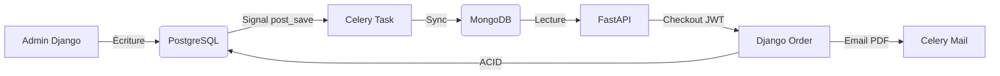

# Plateforme E-Commerce Hybride

> **Architecture hybride** : Django + FastAPI + PostgreSQL + MongoDB + React + Flutter | Docker & Celery

[](https://www.docker.com/)
[](https://www.python.org/)
[](https://www.djangoproject.com/)
[](https://fastapi.tiangolo.com/)
[](https://flutter.dev/)

---

## Table des matières

- [Vue d'ensemble](#vue-densemble)
- [Architecture](#architecture)
- [Clients (Web & Mobile)](#clients-web--mobile)
- [Démarrage rapide](#démarrage-rapide)
- [Configuration réseau & adresse IP](#configuration-réseau--adresse-ip)
- [Structure du projet](#structure-du-projet)
- [Variables d'environnement](#variables-denvironnement)
- [Commandes Docker utiles](#commandes-docker-utiles)
- [Flux métier principaux](#flux-métier-principaux)
- [Dépannage](#dépannage)
- [Sécurité](#sécurité)
- [Contributing](#contributing)

---

## Vue d'ensemble

Plateforme e-commerce B2C avec **séparation des responsabilités** entre un backend transactionnel (Django/PostgreSQL) et une API catalogue haute performance (FastAPI/MongoDB).

| Couche | Technologie | Rôle |
|--------|-------------|------|
| Core Backend | Django 5.x | Auth JWT, utilisateurs, commandes ACID, admin, emails Celery |
| High Perf API | FastAPI | Catalogue MongoDB, recherche, checkout proxy |
| Base relationnelle | PostgreSQL 15 | Utilisateurs, commandes, stocks, factures |
| Base documentaire | MongoDB 7 | Fiches produits synchronisées depuis PostgreSQL |
| Broker / cache | Redis 7 | Celery, cache |
| Workers async | Celery 5 | Sync catalogue PG→MongoDB, emails PDF de confirmation |
| Frontend Web | React (Vite) | Boutique, panier, checkout |
| App Mobile / Web | Flutter | Auth, catalogue, panier, commande, suivi |

### Flux de données



1. **Écriture** : produit créé/modifié dans Django Admin → PostgreSQL
2. **Sync** : Celery met à jour MongoDB (`postgres_id` conservé pour le checkout)
3. **Lecture** : clients React/Flutter consultent le catalogue via FastAPI
4. **Achat** : panier → `POST /api/v2/checkout/confirm` → Django crée la commande → Celery envoie l'email

---

## Architecture

| Service | Port hôte | URL locale |
|---------|-----------|------------|
| Django API | `8000` | `http://localhost:8000/api/v1/` |
| FastAPI | `8001` | `http://localhost:8001/api/v2/` |
| Nginx (optionnel) | `80` | `http://localhost/admin/` |
| PostgreSQL | `5432` | interne Docker |
| MongoDB | `27017` | interne Docker |
| Redis | `6379` | interne Docker |

**Endpoints clés**

| Domaine | Méthode | Endpoint |
|---------|---------|----------|
| Login JWT | POST | `/api/v1/auth/login/` |
| Inscription | POST | `/api/v1/users/register/` |
| Catalogue | GET | `/api/v2/products/` |
| Checkout | POST | `/api/v2/checkout/confirm` |
| Création commande (interne) | POST | `/api/v1/orders/create/` |

---

## Clients (Web & Mobile)

### React (`ecommerce-frontend/`)

- Catalogue FastAPI, panier, checkout, auth Django
- URLs API centralisées dans `src/App.tsx` (à adapter selon le réseau)

### Flutter (`flutter_app/`)

| Écran | Fichier | Fonction |
|-------|---------|----------|
| Connexion | `login_screen.dart` | JWT Django, extraction username depuis email |
| Inscription | `register_screen.dart` | `POST /users/register/` |
| Accueil | `home_screen.dart` | Grille produits MongoDB, recherche, catégories |
| Détail produit | `product_detail_screen.dart` | Fiche produit + ajout panier |
| Panier | `cart_screen.dart` | Récap, passage commande |
| Suivi commande | `order_tracking_screen.dart` | Timeline après checkout |

| Service | Fichier | Rôle |
|---------|---------|------|
| API HTTP | `api_client.dart` | Base URLs Django + FastAPI, injection JWT |
| Auth | `auth_service.dart` | Login, register, logout, session sécurisée |
| Catalogue | `shop_service.dart` | `fetchProducts()` FastAPI |
| Commande | `order_service.dart` | `createOrder()` → checkout FastAPI |

**Lancer Flutter**

```powershell
cd flutter_app
flutter pub get
flutter run -d chrome          # Web (localhost)
flutter run                    # Téléphone / émulateur (IP LAN requise)
```

---

## Démarrage rapide

### Prérequis

```powershell
docker --version          # >= 24.0
docker compose version    # >= 2.20
git --version
# Optionnel : Flutter SDK 3.12+, Node.js 18+ pour le frontend React
```

### Installation

```powershell
git clone https://github.com/TebitR/ecommerce-hybrid.git
cd ecommerce-hybrid

cp .env.example .env
# Éditer .env : mots de passe, ALLOWED_HOSTS, SMTP si emails

docker compose build --no-cache
docker compose up -d postgres mongodb redis
Start-Sleep -Seconds 45

docker compose run --rm django python manage.py migrate
docker compose run --rm django python manage.py createsuperuser

docker compose up -d
```

### Vérification

| Test | URL / commande | Résultat attendu |
|------|----------------|------------------|
| Django Admin | `http://localhost:8000/admin/` | Page de login |
| Django API | `http://localhost:8000/api/v1/` | JSON |
| FastAPI Docs | `http://localhost:8001/docs` | Swagger |
| Produits | `http://localhost:8001/api/v2/products/` | Liste JSON |
| Celery | `docker compose logs -f celery_worker` | Worker actif |

### Frontend React (optionnel)

```powershell
cd ecommerce-frontend
npm install
npm run dev
# → http://localhost:5173
```

---

## Configuration réseau & adresse IP

L'adresse IP de votre machine **change selon le réseau** (Wi-Fi maison, partage de connexion, bureau, VPN).  
Quand vous testez depuis un **téléphone physique** ou un autre appareil sur le LAN, `localhost` ne fonctionne pas : il faut utiliser l'**IP locale de votre PC**.

### Trouver votre IP

```powershell
# Windows
ipconfig
# Repérer "Adresse IPv4" sur Wi-Fi ou Ethernet (ex. 192.168.1.42 ou 172.20.10.4)
```

### Quelle URL utiliser ?

| Contexte | Django | FastAPI |
|----------|--------|---------|
| Chrome Web sur le **même PC** | `http://localhost:8000/api/v1` | `http://localhost:8001/api/v2` |
| **Émulateur Android** | `http://10.0.2.2:8000/api/v1` | `http://10.0.2.2:8001/api/v2` |
| **Téléphone physique** (même Wi-Fi) | `http://VOTRE_IP:8000/api/v1` | `http://VOTRE_IP:8001/api/v2` |

> Le PC et le téléphone doivent être sur le **même réseau**. Vérifiez que le pare-feu Windows autorise les ports `8000` et `8001`.

### Fichiers à modifier quand l'IP change

#### Flutter (prioritaire pour l'app mobile)

| Fichier | Constantes à mettre à jour |
|---------|---------------------------|
| `flutter_app/lib/core/network/api_client.dart` | `_host` |

Exemple pour IP `192.168.1.117` :

```dart
static const String _host = '192.168.1.117';
static const String _djangoBaseUrl = 'http://$_host:8000/api/v1';
static const String _fastApiBaseUrl = 'http://$_host:8001/api/v2';
```

#### React Web

| Fichier | Variable |
|---------|----------|
| `ecommerce-frontend/src/config/api.ts` | `API_HOST` (un seul fichier à modifier) |

Exemple dans `src/config/api.ts` :

```ts
export const API_HOST = '192.168.1.117'
```

#### Backend Django (autoriser les requêtes depuis l'IP)

| Fichier | Action |
|---------|--------|
| `.env` | Ajouter votre IP dans `ALLOWED_HOSTS` |
| `django_app/config/settings/base.py` | Optionnel : ajouter l'origine Flutter Web dans `CORS_ALLOWED_ORIGINS` |

Exemple `.env` :

```env
ALLOWED_HOSTS=localhost,127.0.0.1,0.0.0.0,192.168.1.42
```

Après modification du `.env` :

```powershell
docker compose up -d --force-recreate django celery_worker
```

> Un simple `docker compose restart` ne recharge pas toujours le fichier `.env`.

#### Fichiers qui n'ont pas besoin d'IP (Docker interne)

Ces chemins utilisent les noms de services Docker (`django`, `mongodb`, `postgres`) et ne dépendent pas de votre IP LAN :

- `docker-compose.yml`
- `fastapi_app/app/routers/checkout.py` (`http://django:8000/...`)
- Variables `POSTGRES_HOST`, `MONGODB_URL`, `REDIS_URL` dans `.env`

### Checklist après changement de réseau

1. `ipconfig` → noter la nouvelle IPv4
2. Mettre à jour `api_client.dart` (Flutter) et/ou `App.tsx` (React)
3. Ajouter l'IP dans `ALLOWED_HOSTS` (`.env`)
4. Recréer les conteneurs Django/Celery si `.env` modifié
5. Hot restart Flutter (`R`) ou relancer `flutter run`
6. Tester : login → catalogue → panier → commande

---

## Structure du projet

```
ecommerce-hybrid/
├── .env / .env.example
├── docker-compose.yml
├── README.md
│
├── django_app/                 # Core : auth, users, orders, catalog sync
│   ├── apps/accounts/          # JWT login
│   ├── apps/users/             # Register, profil
│   ├── apps/catalog/           # Produits PG + signals → Celery
│   └── apps/orders/            # Checkout create, emails PDF Celery
│
├── fastapi_app/                # Catalogue MongoDB + checkout proxy
│   └── app/routers/            # catalog, search, checkout
│
├── ecommerce-frontend/         # React + Vite (boutique web)
│   └── src/
│
├── flutter_app/                # App mobile / Flutter Web
│   └── lib/
│       ├── core/
│       │   ├── network/api_client.dart
│       │   ├── services/       # auth, shop, order
│       │   ├── providers/      # cart
│       │   └── theme/
│       └── presentation/screens/
│
└── nginx/                      # Reverse proxy (optionnel)
```

---

## Variables d'environnement

Copier `.env.example` vers `.env` :

```env
SECRET_KEY=changez-moi
DEBUG=True
ALLOWED_HOSTS=localhost,127.0.0.1,0.0.0.0,192.168.1.117

POSTGRES_DB=ecommerce_db
POSTGRES_USER=ecommerce_user
POSTGRES_PASSWORD=...

MONGO_INITDB_ROOT_USERNAME=admin
MONGO_INITDB_ROOT_PASSWORD=...

JWT_SECRET_KEY=changez-moi-clé-identique-django-et-fastapi
JWT_ALGORITHM=HS256

# Email (Celery – confirmation de commande)
EMAIL_HOST=smtp.gmail.com
EMAIL_PORT=587
EMAIL_HOST_USER=votre@gmail.com
EMAIL_HOST_PASSWORD=mot-de-passe-application
DEFAULT_FROM_EMAIL=votre@gmail.com
```

> Ne jamais committer `.env` (déjà dans `.gitignore`).

---

## Commandes Docker utiles

```powershell
docker compose up -d
docker compose down
docker compose logs -f django
docker compose logs -f fastapi
docker compose logs -f celery_worker

docker compose exec django python manage.py migrate
docker compose exec django python manage.py createsuperuser

# Recharger .env après modification
docker compose up -d --force-recreate django celery_worker
```

---

## Flux métier principaux

### Authentification

```
Client → POST /api/v1/auth/login/ { username, password }
       ← { access, refresh }
Token stocké (localStorage React / Secure Storage Flutter)
```

### Checkout (React & Flutter)

```
Client → POST /api/v2/checkout/confirm
         Authorization: Bearer <access>
         { user_id, items: [{ product_postgres_id, quantity }] }
FastAPI → Django /api/v1/orders/create/
Django  → Commande PostgreSQL + Celery send_order_confirmation
```

Le champ **`postgres_id`** dans MongoDB est obligatoire : il lie chaque produit catalogue à l'ID PostgreSQL utilisé au checkout.

---

## Dépannage

| Problème | Solution |
|----------|----------|
| Timeout Flutter / React sur téléphone | Vérifier IP LAN dans `api_client.dart` / `App.tsx` + même Wi-Fi |
| `Connection refused` | `docker compose ps` — Django et FastAPI doivent être `Up` |
| `400` au checkout | Produit sans `postgres_id` → resync Celery ou recréer produit via Django Admin |
| Email non reçu | Vérifier SMTP dans `.env`, logs `celery_worker` |
| `.env` ignoré après edit | `docker compose up -d --force-recreate django celery_worker` |
| Écran rouge Flutter après gros changements | Hot **Restart** (`R`) ou relancer `flutter run` |
| CORS / 403 Django | Ajouter IP dans `ALLOWED_HOSTS` |

---

## Sécurité

- `.env` jamais versionné
- Mots de passe distincts par service
- `DEBUG=False` et `ALLOWED_HOSTS` restreints en production
- JWT partagé Django ↔ FastAPI via `JWT_SECRET_KEY`
- HTTPS via Nginx en production

---

## Contributing

```text
feat(scope): description courte
fix(scope): correction
docs: mise à jour README
```

1. Fork → branche `feat/...` → PR

---

## Licence

Projet à usage interne académique/professionnel. Reproduction interdite sans autorisation.

---

> **État actuel** : Auth JWT, inscription, catalogue MongoDB, panier, checkout Django/Celery, app Flutter UI maquette verte, suivi commande  
> **Dernière mise à jour** : Juin 2026  
> **Mainteneur** : [@TebitR](https://github.com/TebitR)
