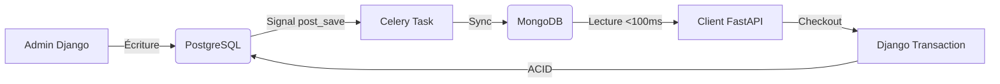
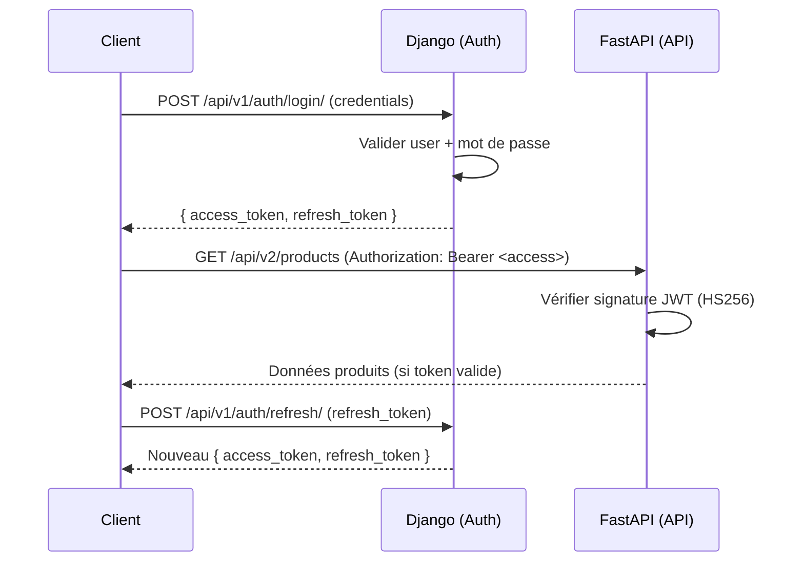

# 🛒 Plateforme E-Commerce Hybride

> **Architecture hybride haute performance** : Django + FastAPI | PostgreSQL + MongoDB | Docker & Celery

[](https://www.docker.com/)
[](https://www.python.org/)
[](https://www.djangoproject.com/)
[](https://fastapi.tiangolo.com/)
[](https://www.postgresql.org/)
[](https://www.mongodb.com/)

---

## 📋 Table des Matières

- [🎯 Vue d'Ensemble](#-vue-densemble)
- [🏗️ Architecture](#️-architecture)
- [🚀 Démarrage Rapide](#-démarrage-rapide)
- [📁 Structure du Projet](#-structure-du-projet)
- [⚙️ Variables d'Environnement](#️-variables-denvironnement)
- [🐳 Commandes Docker Utiles](#-commandes-docker-utiles)
- [👥 Guide Collaborateur](#-guide-collaborateur) ⭐
- [🔐 Sécurité & Bonnes Pratiques](#-sécurité--bonnes-pratiques)
- [🤝 Contributing](#-contributing)
- [📄 Licence](#-licence)

---

## 🎯 Vue d'Ensemble

Ce projet est une **plateforme e-commerce à architecture hybride** qui sépare intelligemment les responsabilités entre deux écosystèmes complémentaires :

| Couche | Technologie | Rôle |
|--------|-------------|------|
| 🔷 **Core Backend** | Django 5.x | Administration, sécurité, logique financière, garanties ACID |
| ⚡ **High Perf API** | FastAPI | Endpoints publics asynchrones, catalogue client, Swagger auto |
| 🗄️ **Base Relationnelle** | PostgreSQL 15 | Utilisateurs, commandes, factures, stocks (intégrité stricte) |
| 📦 **Base Documentaire** | MongoDB 7 | Fiches produits polymorphes, lecture ultra-rapide (<100ms) |
| 🔴 **Broker / Cache** | Redis 7 | Sessions, cache API, file d'attente Celery |
| 🔄 **Workers Async** | Celery 5 | Emails, PDF, synchronisation PostgreSQL → MongoDB |

### 🌊 Flux de Données (Event-Driven)



1. **Écriture** : L'admin crée/modifie un produit via Django Admin → PostgreSQL
2. **Signal** : `post_save` déclenche une tâche Celery via Redis
3. **Synchronisation** : Celery compile et met à jour le document MongoDB
4. **Lecture** : Le client consulte le catalogue via FastAPI → MongoDB
5. **Transaction** : Validation panier → FastAPI → Django → PostgreSQL (ACID)

---

## 🚀 Démarrage Rapide

### Prérequis

```powershell
# Vérifier les versions minimales
docker --version          # >= 24.0
docker compose version    # >= 2.20
git --version             # Requis
```

### Installation en 5 minutes

```powershell
# 1. Cloner le dépôt
git clone https://github.com/TebitR/ecommerce-hybrid.git
cd ecommerce-hybrid

# 2. Configurer les variables d'environnement
cp .env.example .env
# ⚠️ Éditer .env et changer TOUS les mots de passe/clés secrètes

# 3. Construire les images (premier lancement)
docker compose build --no-cache

# 4. Lancer l'infrastructure de base
docker compose up -d postgres mongodb redis
Start-Sleep -Seconds 45  # Attendre les healthchecks

# 5. Appliquer les migrations et créer un superuser
docker compose run --rm django python manage.py migrate
docker compose run --rm django python manage.py createsuperuser

# 6. Créer les index MongoDB
docker compose exec mongodb mongosh -u admin -p ${MONGO_INITDB_ROOT_PASSWORD} ecommerce_catalog --eval "
  db.products.createIndex({ slug: 1 }, { unique: true });
  db.products.createIndex({ 'category.id': 1, is_active: 1 });
  db.products.createIndex({ tags: 1 });
  db.products.createIndex({ postgres_id: 1 }, { unique: true });
  print('✅ Index MongoDB créés !');
"

# 7. Lancer tous les services
docker compose up -d
```

### Vérification

| Service | URL / Commande | Résultat attendu |
|---------|---------------|------------------|
| 🎛️ Django Admin | `http://localhost:80/admin/` | Page de login |
| 📡 Django API | `http://localhost:80/api/v1/` | JSON API REST |
| ⚡ FastAPI Docs | `http://localhost:8001/docs` | Swagger interactif |
| 🗄️ PostgreSQL | `docker compose exec postgres psql -U ecommerce_user -d ecommerce_db -c '\dt'` | Liste des tables |
| 📦 MongoDB | `docker compose exec mongodb mongosh -u admin --eval 'show dbs'` | Bases MongoDB |
| 🔴 Redis | `docker compose exec redis redis-cli ping` | `PONG` |

---

## 📁 Structure du Projet

```
ecommerce-hybrid/
├── docker-compose.yml          # Orchestration des 8 services
├── .env                        # Variables sensibles (NE PAS COMMIT)
├── .env.example                # Template à committer
├── .gitignore
├── README.md                   # Ce fichier
│
├── django_app/                 # SERVICE : Core Backend
│   ├── Dockerfile
│   ├── requirements.txt
│   ├── manage.py
│   ├── config/
│   │   ├── settings/
│   │   │   ├── base.py         # Config centrale (DB, Redis, JWT)
│   │   │   ├── development.py  # Overrides dev (DEBUG=True)
│   │   │   └── production.py   # Overrides prod (DEBUG=False)
│   │   ├── urls.py             # Routeur principal
│   │   └── celery.py           # Initialisation Celery
│   └── apps/
│       ├── accounts/           # Auth, UserProfile, Address
│       ├── catalog/            # Product, Category + sync MongoDB
│       └── orders/             # Order, Invoice, Payment (ACID)
│
├── fastapi_app/                # SERVICE : High-Performance API
│   ├── Dockerfile
│   ├── requirements.txt
│   └── app/
│       ├── main.py             # App FastAPI + lifespan
│       ├── config.py           # Settings Pydantic
│       ├── database.py         # Connexion Motor (MongoDB async)
│       ├── dependencies.py     # JWT, get_db injections
│       ├── routers/            # Endpoints API
│       │   ├── catalog.py      # GET /products, /products/{slug}
│       │   ├── search.py       # Recherche à facettes
│       │   ├── cart.py         # CRUD panier temporaire
│       │   └── reviews.py      # Avis produits
│       └── schemas/            # Modèles Pydantic de validation
│
└── nginx/                      # SERVICE : Reverse Proxy
    └── nginx.conf              # Routing /api/v1/ → Django, /api/v2/ → FastAPI
```

---

## ⚙️ Variables d'Environnement

Copiez `.env.example` en `.env` et personnalisez :

```env
# ==================== DJANGO ====================
SECRET_KEY=changez-moi-50-caracteres-min
DEBUG=True
ALLOWED_HOSTS=localhost,127.0.0.1

# ==================== POSTGRESQL ====================
POSTGRES_DB=ecommerce_db
POSTGRES_USER=ecommerce_user
POSTGRES_PASSWORD=votre-mot-de-passe-secure

# ==================== MONGODB ====================
MONGO_INITDB_ROOT_USERNAME=admin
MONGO_INITDB_ROOT_PASSWORD=votre-mot-de-passe-secure
MONGO_INITDB_DATABASE=ecommerce_catalog

# ==================== REDIS ====================
REDIS_URL=redis://redis:6379/0
CELERY_BROKER_URL=redis://redis:6379/1

# ==================== JWT ====================
JWT_SECRET_KEY=changez-moi-clé-jwt-unique
JWT_ALGORITHM=HS256
JWT_ACCESS_TOKEN_EXPIRE_MINUTES=30
```

> ⚠️ **Ne commitez jamais `.env`** — il est déjà dans `.gitignore`.

---

## 🐳 Commandes Docker Utiles

```powershell
# ── Gestion des services ─────────────────────────────
docker compose up -d                    # Lancer tous les services
docker compose down                     # Arrêter tous les services
docker compose down -v                  # Arrêter + supprimer volumes (⚠️ RESET)
docker compose restart django           # Redémarrer un service
docker compose ps                       # Voir l'état des services

# ── Logs & Debug ────────────────────────────────────
docker compose logs -f django           # Logs Django en temps réel
docker compose logs -f fastapi          # Logs FastAPI
docker compose logs -f celery_worker    # Logs Celery

# ── Commandes Django ────────────────────────────────
docker compose exec django python manage.py shell      # Shell interactif
docker compose exec django python manage.py makemigrations  # Créer migrations
docker compose exec django python manage.py migrate         # Appliquer migrations
docker compose exec django python manage.py createsuperuser # Créer admin

# ── Monitoring ──────────────────────────────────────
docker stats                            # Ressources en temps réel
docker compose exec postgres pg_top     # Monitor PostgreSQL (si installé)

# ── Backup / Restore PostgreSQL ─────────────────────
docker compose exec postgres pg_dump -U ecommerce_user ecommerce_db > backup.sql
docker compose exec -T postgres psql -U ecommerce_user ecommerce_db < backup.sql
```

---

## 👥 Guide Collaborateur

> 🎯 **Objectif** : Permettre à un nouveau développeur d'avoir un environnement de développement **identique à 100%** en moins de 15 minutes.

### 📦 Étape 1 : Cloner et Préparer

```powershell
# 1. Cloner le dépôt
git clone https://github.com/TebitR/ecommerce-hybrid.git
cd ecommerce-hybrid

# 2. Vérifier que Docker Desktop est running
docker info | Select-String "Server Version"
```

### 🔐 Étape 2 : Obtenir le fichier `.env`

Le fichier `.env` contient les secrets et **n'est pas versionné**. Pour l'obtenir :

1. Demander le fichier `.env` au mainteneur via un **canal chiffré** (Signal, Bitwarden, etc.)
2. Le placer à la racine du projet : `C:\Users\TonNom\ecommerce-hybrid\.env`
3. Vérifier qu'il est bien ignoré par Git :
   ```powershell
   git status | Select-String ".env"  # Aucun résultat = OK
   ```

### 🐳 Étape 3 : Construire et Lancer

```powershell
# 1. Construire les images (première fois)
docker compose build --no-cache

# 2. Lancer l'infrastructure de base
docker compose up -d postgres mongodb redis
Start-Sleep -Seconds 45  # Attendre les healthchecks

# 3. Appliquer les migrations
docker compose run --rm django python manage.py migrate

# 4. Créer VOTRE compte superuser (ne pas utiliser celui du .env)
docker compose run --rm django python manage.py createsuperuser
# Suivre les invites : username=votre_nom, email=votre@email, password=****

# 5. Créer les index MongoDB (remplacer le mot de passe par celui du .env)
docker compose exec mongodb mongosh -u admin -p VOTRE_MDP_MONGO ecommerce_catalog --eval "
  db.products.createIndex({ slug: 1 }, { unique: true });
  db.products.createIndex({ 'category.id': 1, is_active: 1 });
  db.products.createIndex({ tags: 1 });
  db.products.createIndex({ postgres_id: 1 }, { unique: true });
  print('✅ Index MongoDB créés !');
"

# 6. Lancer tous les services
docker compose up -d
Start-Sleep -Seconds 20
```

### 🧪 Étape 4 : Vérifications

| Test | Commande / URL | Résultat attendu |
|------|---------------|------------------|
| Admin | `http://localhost:80/admin/` | Login Django → accès dashboard |
| FastAPI Docs | `http://localhost:8001/docs` | Swagger UI chargé |
| PostgreSQL | `docker compose exec postgres psql -U ecommerce_user -d ecommerce_db -c '\dt'` | Tables Django listées |
| MongoDB | `docker compose exec mongodb mongosh -u admin --eval 'db.adminCommand("ping")'` | `{ ok: 1 }` |
| Redis | `docker compose exec redis redis-cli ping` | `PONG` |

✅ Si tous les tests passent → **Environnement 100% fonctionnel**.

### 🔄 Workflow de Développement

```powershell
# 1. Créer une branche par fonctionnalité
git checkout -b feature/ma-nouvelle-fonctionnalite

# 2. Développer et tester localement
# (les modifications dans django_app/ et fastapi_app/ sont montées en volume)

# 3. Après un `git pull`, reconstruire si besoin
git pull origin main
docker compose build --no-cache django fastapi
docker compose up -d

# 4. Commiter avec la convention Conventional Commits
git add .
git commit -m "feat(catalog): add product search by tags"
git push origin feature/ma-nouvelle-fonctionnalite

# 5. Ouvrir une Pull Request sur GitHub
```

### 🚨 Dépannage Rapide

| Problème | Solution |
|----------|----------|
| `Authentication failed` MongoDB | Vérifier que le mot de passe dans `.env` correspond à celui utilisé dans les commandes `mongosh` |
| `502 Bad Gateway` sur `/admin/` | Django n'a pas fini de démarrer → attendre 30s ou `docker compose restart django` |
| `.env` apparaît dans `git status` | `git rm --cached .env` puis commit |
| Port 80 déjà utilisé | Modifier `nginx` dans `docker-compose.yml` : `ports: - '8080:80'` puis accéder via `localhost:8080` |
| Migrations Django échouent | `docker compose run --rm django python manage.py migrate --run-syncdb` |

---

## 🔐 Sécurité & Bonnes Pratiques

### Checklist de Sécurité

- [ ] `.env` **jamais committé** dans Git (déjà dans `.gitignore`)
- [ ] Mots de passe forts et **différents** pour chaque service
- [ ] `DEBUG=False` et `ALLOWED_HOSTS` restreints en production
- [ ] HTTPS activé via Nginx + Let's Encrypt en production
- [ ] Rotation automatique des JWT activée (`ROTATE_REFRESH_TOKENS: True`)
- [ ] Backups réguliers PostgreSQL et MongoDB configurés
- [ ] Images Docker scannées avec `docker scout` ou `trivy`
- [ ] Principe du moindre privilège appliqué aux utilisateurs DB

### Flux JWT (Authentification Centralisée)



---

## 🤝 Contributing

1. Fork le projet
2. Créer une branche fonctionnalité : `git checkout -b feat/ma-fonctionnalite`
3. Commiter avec Conventional Commits : `git commit -m 'feat(catalog): add facet search'`
4. Pousser la branche : `git push origin feat/ma-fonctionnalite`
5. Ouvrir une Pull Request

### Convention de Commits

```
<type>(<scope>): <description>

[optional body]

[optional footer]
```

| Type | Signification | Exemple |
|------|--------------|---------|
| `feat` | Nouvelle fonctionnalité | `feat(auth): add JWT refresh endpoint` |
| `fix` | Correction de bug | `fix(mongo): handle auth timeout on sync` |
| `docs` | Documentation | `docs: add collaborator onboarding guide` |
| `chore` | Tâche technique | `chore: update docker-compose healthchecks` |
| `refactor` | Refactoring sans changement fonctionnel | `refactor(settings): split base/dev/prod configs` |

---

## 📄 Licence

Ce projet est confidentiel et destiné à un usage interne académique/professionnel.  
Toute reproduction ou distribution sans autorisation écrite est interdite.

---

> 🚀 **Prochaine phase** : Authentification JWT + Synchronisation Django → MongoDB  
> 📅 **Dernière mise à jour** : Avril 2026  
> 👤 **Mainteneur** : [@TebitR](https://github.com/TebitR)

---

✨ *Développé avec ❤️ en suivant les bonnes pratiques Docker, Django et FastAPI.*