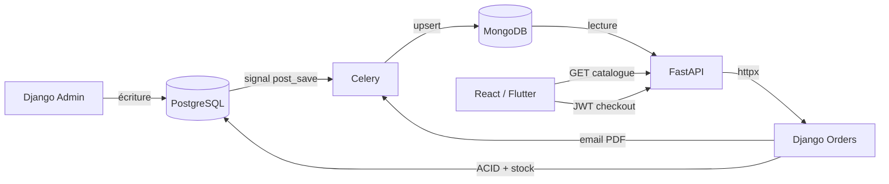

# E-Commerce Hybride

Plateforme e-commerce B2C full-stack avec architecture **write / read** séparée.

**Django + PostgreSQL** gèrent l’auth JWT, le stock et les commandes ACID.  
**FastAPI + MongoDB** servent le catalogue et la recherche.  
**Celery + Redis** synchronisent les données et envoient les emails PDF.  
Deux clients consomment la même API : **React** (web) et **Flutter** (mobile / web).

Tout le backend tourne avec **Docker Compose** — un collaborateur peut cloner et démarrer en quelques minutes.

[](https://www.docker.com/)
[](https://www.python.org/)
[](https://www.djangoproject.com/)
[](https://fastapi.tiangolo.com/)
[](https://react.dev/)
[](https://flutter.dev/)

---

## Table des matières

- [Démarrage collaborateur (5 min)](#démarrage-collaborateur-5-min)
- [Prérequis](#prérequis)
- [Vérifier que tout tourne](#vérifier-que-tout-tourne)
- [Lancer les clients](#lancer-les-clients)
- [Architecture](#architecture)
- [Structure du monorepo](#structure-du-monorepo)
- [Services & ports](#services--ports)
- [API essentielles](#api-essentielles)
- [Variables d’environnement](#variables-denvironnement)
- [Commandes du quotidien](#commandes-du-quotidien)
- [Réseau & IP (mobile / LAN)](#réseau--ip-mobile--lan)
- [Flux métier](#flux-métier)
- [Contribution](#contribution)
- [Dépannage](#dépannage)
- [Sécurité](#sécurité)

---

## Démarrage collaborateur (5 min)

Objectif : cloner le repo et avoir toute la stack backend opérationnelle via Docker.

```bash
# 1. Cloner
git clone https://github.com/TebitR/ecommerce-hybrid.git
cd ecommerce-hybrid

# 2. Configurer l’environnement (ne jamais committer .env)
cp .env.example .env
# Éditer .env : mots de passe, JWT_SECRET_KEY, ALLOWED_HOSTS, SMTP (optionnel)

# 3. Construire et démarrer tous les services
docker compose up -d --build

# 4. Créer un superuser Django (admin)
docker compose exec django python manage.py createsuperuser
```

Les migrations Django sont exécutées automatiquement au démarrage du conteneur `django`.

Ensuite ouvre :

| Service | URL |
|---------|-----|
| Django Admin | http://localhost:8000/admin/ |
| FastAPI Docs (Swagger) | http://localhost:8001/docs |
| Catalogue produits | http://localhost:8001/api/v2/products/ |

Tu es prêt à collaborer.

---

## Prérequis

| Outil | Version min. | Obligatoire ? |
|-------|--------------|---------------|
| [Docker Desktop](https://www.docker.com/products/docker-desktop/) | 24+ | Oui (backend) |
| Docker Compose | 2.20+ | Oui (inclus avec Docker Desktop) |
| Git | 2.x | Oui |
| [Node.js](https://nodejs.org/) | 18+ | Non (seulement React) |
| [Flutter SDK](https://flutter.dev/) | 3.12+ | Non (seulement Flutter) |

> Tant que tu touches uniquement au backend, **Docker suffit**.  
> Installe Node ou Flutter seulement si tu travailles sur un client.

---

## Vérifier que tout tourne

```bash
docker compose ps
```

Tous les services doivent être `Up` (ou `healthy` pour postgres / mongodb / redis) :

- `ecommerce_postgres`
- `ecommerce_mongodb`
- `ecommerce_redis`
- `ecommerce_django`
- `ecommerce_fastapi`
- `ecommerce_celery`
- `ecommerce_celery_beat`
- `ecommerce_nginx`

Tests rapides :

```bash
# Health FastAPI
curl http://localhost:8001/health

# Catalogue
curl http://localhost:8001/api/v2/products/

# Logs si quelque chose coince
docker compose logs -f django
docker compose logs -f fastapi
docker compose logs -f celery_worker
```

---

## Lancer les clients

Les frontends **ne sont pas** dans Docker Compose : ils tournent en local et appellent les APIs.

### React (boutique web)

```bash
cd ecommerce-frontend
npm install
npm run dev
# → http://localhost:5173
```

Config API centralisée : `ecommerce-frontend/src/config/api.ts`  
Pour tester sur le même PC, tu peux mettre `localhost` :

```ts
export const API_HOST = 'localhost'
```

### Flutter (mobile / web)

```bash
cd flutter_app
flutter pub get
flutter run -d chrome          # Web sur le même PC
flutter run                    # Téléphone / émulateur
```

Config API centralisée : `flutter_app/lib/core/network/api_client.dart`

```dart
static const String host = 'localhost'; // ou ton IP LAN pour un téléphone
```

---

## Architecture

Séparation claire des responsabilités :

| Couche | Techno | Rôle |
|--------|--------|------|
| Écriture | Django 5 + PostgreSQL 15 | Auth JWT, users, stock, commandes ACID, admin, médias |
| Lecture | FastAPI + MongoDB 7 | Catalogue, recherche, proxy checkout |
| Async | Celery 5 + Redis 7 | Sync PG → Mongo, emails PDF |
| Web | React 19 + Vite + TypeScript + Tailwind | Boutique, panier, checkout |
| Mobile | Flutter + Dio + Provider | Auth, catalogue, panier, suivi |
| Proxy | Nginx | `/api/v1` → Django, `/api/v2` → FastAPI |



**En une phrase :** on écrit dans PostgreSQL, on lit dans MongoDB, on commande via JWT, et Celery fait le pont.

---

## Structure du monorepo

```text
ecommerce-hybrid/
├── .env.example              # Modèle de config (à copier en .env)
├── docker-compose.yml        # Stack complète
├── README.md
│
├── django_app/               # Backend transactionnel (écriture)
│   ├── apps/accounts/        # Login / refresh JWT
│   ├── apps/users/           # Register, profil, commandes user
│   ├── apps/catalog/         # Produits PG + sync Celery → Mongo
│   └── apps/orders/          # Création commande ACID + emails
│
├── fastapi_app/              # API catalogue (lecture)
│   └── app/routers/          # products, search, checkout proxy
│
├── ecommerce-frontend/       # Client React (Vite)
│   └── src/config/api.ts     # ← IP / host API (un seul endroit)
│
├── flutter_app/              # Client Flutter
│   └── lib/core/network/     # ← host API (un seul endroit)
│
└── nginx/                    # Reverse proxy (port 80)
```

---

## Services & ports

| Service | Port hôte | URL utile |
|---------|-----------|-----------|
| Django | `8000` | http://localhost:8000/admin/ |
| FastAPI | `8001` | http://localhost:8001/docs |
| Nginx | `80` | http://localhost/api/v1/ … |
| PostgreSQL | `5432` | interne Docker |
| MongoDB | `27017` | interne Docker |
| Redis | `6379` | interne Docker |
| React (local) | `5173` | http://localhost:5173 |
| Flutter Web | `8080`* | selon `flutter run` |

\* Port Flutter Web variable selon l’environnement.

À l’intérieur de Docker, les services se parlent par **nom** (`django`, `postgres`, `mongodb`, `redis`) — pas besoin d’IP LAN pour ça.

---

## API essentielles

| Action | Méthode | Endpoint | Auth |
|--------|---------|----------|------|
| Login | `POST` | `/api/v1/auth/login/` | Non |
| Refresh token | `POST` | `/api/v1/auth/refresh/` | Non |
| Inscription | `POST` | `/api/v1/users/register/` | Non |
| Profil | `GET` | `/api/v1/users/profile/` | JWT |
| Mes commandes | `GET` | `/api/v1/users/orders/` | JWT |
| Catalogue | `GET` | `/api/v2/products/` | Non |
| Recherche | `GET` | `/api/v2/search` | Non |
| Checkout | `POST` | `/api/v2/checkout/confirm` | JWT |

Docs interactives : **http://localhost:8001/docs**

---

## Variables d’environnement

1. Copie le modèle : `cp .env.example .env`
2. Remplace tous les `CHANGEZ-MOI`
3. **Ne commit jamais** `.env` (déjà dans `.gitignore`)

Points critiques :

| Variable | Pourquoi c’est important |
|----------|--------------------------|
| `SECRET_KEY` | Sécurité Django |
| `JWT_SECRET_KEY` | **Doit être identique** pour Django et FastAPI |
| `ALLOWED_HOSTS` | Ajoute ton IP LAN pour tests mobile |
| `POSTGRES_*` / `MONGO_*` | Identifiants des bases |
| `EMAIL_*` | Optionnel — confirmation de commande par mail |

Après modification du `.env` :

```bash
docker compose up -d --force-recreate django celery_worker fastapi
```

> Un simple `restart` ne recharge pas toujours le fichier `.env`.

---

## Commandes du quotidien

```bash
# Démarrer / arrêter
docker compose up -d
docker compose down

# Rebuild après changement Dockerfile / deps
docker compose up -d --build

# Logs
docker compose logs -f django
docker compose logs -f fastapi
docker compose logs -f celery_worker

# Django
docker compose exec django python manage.py migrate
docker compose exec django python manage.py createsuperuser
docker compose exec django python manage.py sync_catalog_to_mongo

# Shell Django / bash
docker compose exec django python manage.py shell
docker compose exec django bash
```

### Premier produit de démo

1. Va sur http://localhost:8000/admin/
2. Crée une **catégorie**, puis un **produit** (avec image si tu veux)
3. Celery synchronise automatiquement vers MongoDB
4. Vérifie : http://localhost:8001/api/v2/products/

Si besoin de forcer la sync :

```bash
docker compose exec django python manage.py sync_catalog_to_mongo
```

---

## Réseau & IP (mobile / LAN)

`localhost` fonctionne **uniquement sur la machine qui héberge Docker**.  
Pour un **téléphone physique**, utilise l’IP LAN de ton PC.

### Trouver ton IP

```powershell
# Windows
ipconfig
# → Adresse IPv4 (ex. 192.168.1.42 ou 172.20.10.4)
```

```bash
# macOS / Linux
ip addr   # ou ifconfig
```

### Quelle adresse utiliser ?

| Contexte | Host à mettre |
|----------|---------------|
| Même PC (Chrome / Flutter Web) | `localhost` |
| Émulateur Android | `10.0.2.2` |
| Téléphone réel (même Wi‑Fi) | ton IP LAN |

### Fichiers à mettre à jour (3 endroits max)

| Fichier | Variable |
|---------|----------|
| `flutter_app/lib/core/network/api_client.dart` | `host` |
| `ecommerce-frontend/src/config/api.ts` | `API_HOST` |
| `.env` → `ALLOWED_HOSTS` | ajoute ton IP, puis recreate Django |

Exemple Flutter :

```dart
static const String host = '172.20.10.4';
```

Exemple React :

```ts
export const API_HOST = '172.20.10.4'
```

Exemple `.env` :

```env
ALLOWED_HOSTS=localhost,127.0.0.1,10.0.2.2,django,172.20.10.4
```

Puis :

```bash
docker compose up -d --force-recreate django celery_worker
```

Le PC et le téléphone doivent être sur le **même réseau**. Autorise les ports `8000` et `8001` dans le pare-feu si besoin.

---

## Flux métier

### Auth

```text
Client  → POST /api/v1/auth/login/  { username, password }
        ← { access, refresh }
Stockage : localStorage (React) / flutter_secure_storage (Flutter)
```

### Catalogue

```text
Admin Django → PostgreSQL → Celery sync → MongoDB → FastAPI GET /products/
```

Le champ MongoDB `postgres_id` lie chaque fiche catalogue à l’ID PostgreSQL (indispensable pour le checkout).

### Checkout

```text
Client  → POST /api/v2/checkout/confirm
          Authorization: Bearer <access>
          { items: [{ product_postgres_id, quantity }, ...] }
FastAPI → Django /api/v1/orders/create/
Django  → transaction ACID + réservation stock
Celery  → email PDF de confirmation
```

### Images produit

- Upload via Django Admin (`Product.image`)
- Sync Celery envoie le chemin relatif (`/media/products/...`) dans MongoDB
- Flutter reconstruit l’URL absolue avec `ApiClient.djangoOrigin`

---

## Contribution

### Branches

```text
main              # stable
feat/<sujet>      # nouvelle fonctionnalité
fix/<sujet>       # correction
docs/<sujet>      # documentation
```

### Convention de commits

```text
feat(catalog): sync image relative vers MongoDB
fix(orders): corriger réservation de stock
docs(readme): clarifier onboarding Docker
chore(docker): monter volume media sur Celery
```

### Workflow collaboratif

1. `git pull origin main`
2. Créer une branche `feat/...` ou `fix/...`
3. Développer / tester avec `docker compose`
4. Vérifier que `.env` n’est **pas** dans le commit
5. Ouvrir une Pull Request avec :
   - résumé du changement
   - comment tester (URLs / commandes)
6. Review → merge

### Checklist avant PR

- [ ] `docker compose up -d` démarre sans erreur
- [ ] Les endpoints touchés répondent
- [ ] Pas de secrets (`.env`, mots de passe, tokens)
- [ ] README / docs mis à jour si le workflow change
- [ ] Message de commit clair

---

## Dépannage

| Problème | Cause probable | Solution |
|----------|----------------|----------|
| `Connection refused` | Conteneur down | `docker compose ps` puis `docker compose up -d` |
| Timeout depuis le téléphone | Mauvaise IP / Wi‑Fi | Vérifier `host` / `API_HOST` + même réseau |
| `400` au checkout | Produit sans `postgres_id` | Recréer le produit via Admin ou `sync_catalog_to_mongo` |
| Images en 📦 | Pas d’image uploadée / media inaccessible | Uploader une image Admin + ouvrir `http://HOST:8000/media/...` |
| Email non reçu | SMTP manquant / Celery down | Vérifier `EMAIL_*` + `docker compose logs celery_worker` |
| `.env` ignoré | Conteneur pas recréé | `docker compose up -d --force-recreate django celery_worker fastapi` |
| Port déjà utilisé | Conflit local | Arrêter l’autre process ou changer le mapping dans `docker-compose.yml` |
| Migrations manquantes | Image / volume ancien | `docker compose exec django python manage.py migrate` |

---

## Sécurité

- `.env` **jamais** versionné
- Mots de passe distincts (Postgres, Mongo, JWT, Django)
- `JWT_SECRET_KEY` partagé uniquement entre Django et FastAPI
- En production : `DEBUG=False`, `ALLOWED_HOSTS` restreints, HTTPS derrière Nginx
- Ne pas committer de dumps DB, tokens, ou fichiers `media/` sensibles

---

## État du projet

| Domaine | Statut |
|---------|--------|
| Auth JWT / register / reset password | OK |
| Catalogue MongoDB + sync Celery | OK |
| Checkout ACID + emails PDF | OK |
| Clients React + Flutter | OK |
| Images produit (Admin → Mongo → Flutter) | OK |
| Paiement Stripe / PayPal | WIP |
| Panier serveur Mongo | WIP |
| Hardening prod (HTTPS strict, CORS) | WIP |

---

## Licence

Projet académique / portfolio. Usage et reproduction soumis à autorisation du mainteneur.

---

**Mainteneur :** [@TebitR](https://github.com/TebitR)  
**Dernière mise à jour :** Novembre 2026
